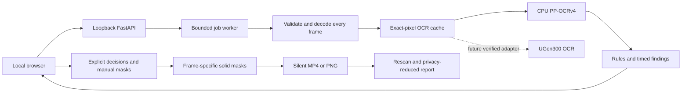

# DemoSafe architecture

DemoSafe is a local review tool for a support engineer who needs to share a short screen recording. It finds supported visible text patterns, lets the engineer decide what to hide, and creates a separately redacted, silent copy. It is not a universal data-loss prevention system.

## Processing and trust boundaries

The application receives pixels and optional user keywords. Benchmark annotations never enter the inference pipeline. No cloud inference or telemetry service is part of this architecture. Package installation and separately producing the competition narration are external activities; this statement is not a packet-capture or sandbox audit.

## Current processing behavior

- The server binds to `127.0.0.1`; a single worker bounds concurrent media processing. Inputs are limited to 100 MB, 60 seconds, 1920×1080 and 30 FPS. Constant-frame-rate H.264 is the supported demonstration path.
- RapidOCR 1.4.4 executes PP-OCRv4 detection and recognition through ONNX Runtime CPU; angle classification is disabled. Each decoded frame is considered. Only byte-identical decoded pixels reuse an OCR result through a bounded cache.
- Rules identify emails, selected phone formats, explicitly labeled/prefixed credential-like text and custom keywords. Findings are grouped over time while original per-frame boxes are retained for masking.
- The operator can keep or redact each finding and add manual timed rectangles. UI timing may be displayed to hundredths; this is display precision, not a guarantee of sub-frame timing accuracy.
- Export preserves the original file, writes opaque masks and removes the entire video audio track. PNG is used for images; video is encoded as H.264 MP4. A rescan uses the same OCR and rules, so correlated misses remain possible.
- Downloaded reports omit detected plaintext. The original media and in-memory OCR review data still contain sensitive content. Files are local, not encrypted by the application, and must be managed deliberately.

## Interfaces and release hardening

The existing job interface covers create, status, cancellation, export, media and report access. Job states are `queued`, `analyzing`, `ready`, `exporting`, `done`, `cancelled` and `error`. Export decisions are explicit, and errors must not become successful results.

The current release adds `POST /api/session` for local session bootstrap and an authenticated `DELETE /api/jobs/{id}` for deliberate local cleanup. Exact Origin checks protect writes. Deletion waits until the worker Future is complete: cancelled status alone does not prove a running decoder/OCR call has stopped. Backend tests and live authentication/origin checks passed. The clean-environment browser flow also covered cancellation, four findings, keep/redact decisions, a timed manual mask, export/download, stale-output warning and re-export. The 12-second demonstration preserved all 120 frames and the source file; its manual mask covered all 120 intended frames. These are verified cases, not a multi-user security certification. See `reports/security_review_v2.json`, `reports/validation_ui_v2.json` and the final test report for scope.

The OCR interface is one BGR `uint8` frame to a list of text, confidence and source-pixel boxes. A future UGen backend must implement this interface and report its actual model/backend. A device failure is an error, not an implicit CPU fallback. See [hardware roadmap](HARDWARE_ROADMAP.md).

## What the evidence means

The legacy synthetic benchmark reported 23/24 events found in development and 24/24 in the original held-out split. Both used narrow, controlled fictional recordings. The held-out split also reported 282/282 sensitive frame regions meeting the evaluator's mask-coverage threshold. These are different units and must not be combined into a universal accuracy claim.

The new frozen runs are complete, with 12 clips, 24 annotated events and 336 sensitive frame regions per split. Development detected 20/24 events at least once (83.33%) and fully masked 237/336 annotated frame regions (70.54%). Held-out detected 18/24 events (75.00%) and fully masked 231/336 regions (68.75%). The denominator includes missed and partially covered regions. Correct geometry on selected masks, 237/237 and 231/231 respectively, only verifies export correctness for selected rectangles. Both splits produced zero unmatched event alerts and 6/6 clean negatives in this controlled corpus; this is not a general false-positive rate or privacy guarantee.

The 1 Hz replay averaged 45.00% event recall in development (25.00–54.17%) and 43.33% in held-out (25.00–50.00%) across all 15 phases. It reuses saved observations and measures detection/work counts, not elapsed-time speedup. The held-out run resumed after the participant requested a shutdown at 10/12 completed clips; the final two clips continued the same frozen evaluation. Restarted process/model initialization and shared-host activity make the reported wall times observed timings, not a controlled cross-split or hardware comparison.

The held-out spreadsheet C positive clip wholly missed a 2-second credential and a 1-second custom keyword. Only 11/56 annotated frame regions were fully masked, yet the same-model output rescan returned `passed` with zero findings. The legacy dark-terminal miss also remains known. These cases show why event recall, full truth-region coverage and a rescan status must stay separate. All failed events and residual regions remain listed in `reports/evaluation_v2_results.md`.

Both completeness gates passed and an independent review passed 969 checks, including observation replay, all 15 sampling phases, decoded output pixels, frozen hashes and preservation of the first 10 completed held-out samples. See `reports/evaluation_v2_results.json` and `reports/evaluation_v2_independent_review.json`. A completeness gate does not certify high accuracy. Mock adapter tests, a UI recording and an OCR benchmark answer different questions; none alone proves privacy safety or real-world adoption.
